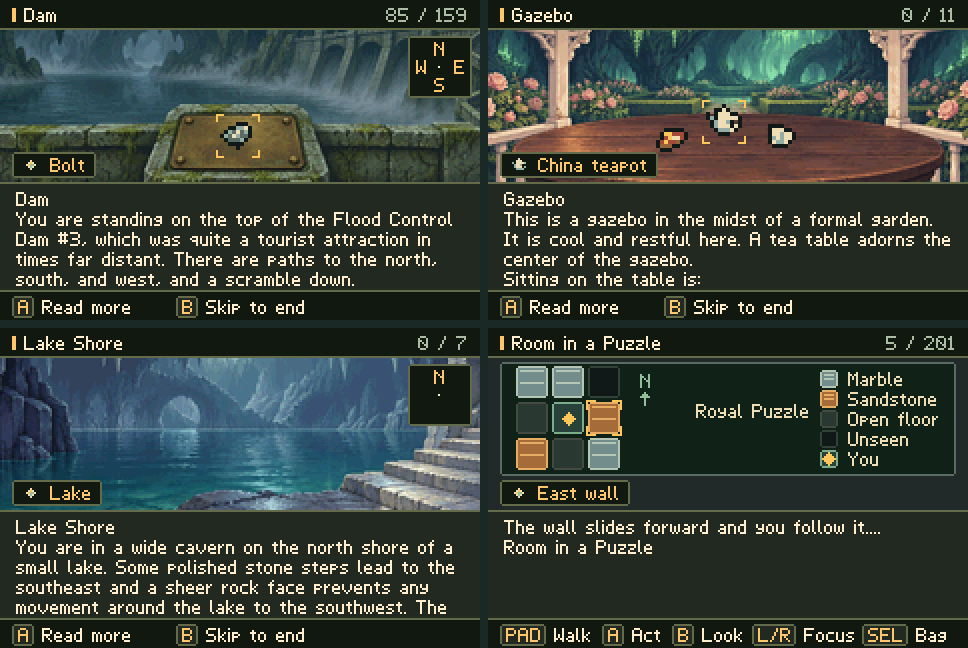

# Zork Trilogy for Game Boy Advance

[**Play Zork Trilogy**](https://github.com/jfgordon2/zork/releases/latest/download/zork-trilogy.gba) contains Infocom’s complete Zork I, II, and III stories on a single cartridge. Copy the ROM into your handheld’s GBA ROM folder or open it in mGBA. Choose a chapter and select **New game**.



[Exploration map and Great Cavern screenshots](docs/images/exploration-preview.png)

[Alternate routes and room art in mGBA](docs/images/alternate-preview.png)

[Character encounters in mGBA](docs/images/encounter-preview.png)

[Room items in mGBA](docs/images/item-preview.png) and [item art prompts](assets/items/README.md)

[Zork I repeat audit](zork-i-re-audit.md) · [Updated Zork I scenes](docs/images/zork-i-followup-preview.png) · [Screen QA checklist](qa-screen-checklist.md)

[Mine scenery, UI access, and save checks](docs/images/zork-i-mine-preview.png)

[Scenery generation rules](assets/SCENERY_RULES.md)

[Background asset wiring audit](background-asset-wiring-audit.md)

[Zork II visual and QA audit](zork-ii-audit.md) · [Selected Zork II issues](docs/images/zork-ii-audit-preview.png) · [All 73 route scenes](docs/images/zork-ii-scene-review.png)

[Zork II scenery update and re-audit](zork-ii-re-audit.md) · [Updated game screens](docs/images/zork-ii-updated-preview.png) · [Updated route scenes](docs/images/zork-ii-updated-scenes.png)

[Zork II completed follow-ups and audit](zork-ii-completion-audit.md) · [Latest game screens](docs/images/zork-ii-completion-preview.png) · [Completed optional scenery](docs/images/zork-ii-completion-scenes.png)

[Route-driven visual consistency and QA audit](visual-route-qa-audit.md) · [Zork III re-audit](zork-iii-re-audit.md) · [Initial Zork III audit](zork-iii-audit.md) · [Connected-scene consistency pass](zork-iii-consistency-pass.md) · [Current backgrounds](docs/images/zork-iii-connected-scenes.png) · [Connected in-game states](docs/images/zork-iii-connected-scene-states.png) · [72-room renderer review](docs/images/zork-iii-scene-review.png) · [Per-screen capture matrix](zork-iii-audit-screens.csv)

[Asset / story consistency review](asset-story-consistency-audit.md) · [Follow-up full sweep](asset-story-consistency-audit-followup.md) · [Code review](code-review.md) · [Room and encounter placement across connected scenes](docs/art-history/encounter-options/encounter-routes.png)

Compare two pixel-art designs for each encounter in [Zork I](docs/art-history/encounter-options/zork-i.png), [Zork II](docs/art-history/encounter-options/zork-ii.png), and [Zork III](docs/art-history/encounter-options/zork-iii.png). The boards include alternate poses for encounters that change during play.

See all 21 encounters in the shared ImageGen style on the [Zork I lineup](docs/art-history/encounter-options/imagegen-lineup-i.png), [Zork II lineup](docs/art-history/encounter-options/imagegen-lineup-ii.png), and [Zork III lineup](docs/art-history/encounter-options/imagegen-lineup-iii.png).

Compare the encounter style studies in [Zork I](docs/art-history/encounter-options/imagegen-zork-i.png), [Zork II](docs/art-history/encounter-options/imagegen-zork-ii.png), and [Zork III](docs/art-history/encounter-options/imagegen-zork-iii.png). See the [art brief and prompts](docs/art-history/encounter-options/art-brief.md) for the human proportions, shading rules, and sprite sizes.

## Controls

| GBA input | In a room | In a menu |
| --- | --- | --- |
| Up | Open **Paths**. | Select an entry. |
| Left / Right / Down | — | Select an entry. |
| L / R | Cycle through nearby objects and **Room actions**. | Page through long lists. |
| A | Open the selected object's actions or read the next page. | Confirm. |
| B | Look around or skip to the last page of a response. | Back. |
| Select | Open the bag and act on carried objects. | |
| Start | Open the pause menu for saves, the map, controls, and the last story response. | Resume from pause. |

Press **Up** in a room to open **Paths**. Use the D-pad to choose a direction and **A** to try it. Paths lists possible exits represented by the current room, among north, east, south, west, the four diagonals, up, down, in, and out. The same exits stay visible in the top bar during exploration, including in dark rooms; compact right triangles point toward the four diagonal exits, while **U**, **D**, **I**, and **O** stand for up, down, in, and out. Paths spells out diagonal names. Teal marks a known route back to the room you just left; if that exit is conditional, it keeps its dim text and gets a teal underline. Other conditional routes appear dimmed. In Zork III's Royal Puzzle, a surveyed map hides compass moves blocked by the maze walls. Zork II's Oddly-angled Rooms list every direction because the story reorients their passages; the Carousel also offers its randomized **In** and **Out** moves. Some listed routes depend on story conditions, so the story may still block one until its condition is met. You can also open Paths through **Room actions**. Choose **Room actions → Nearby objects** to see the room's objects in one list. **More actions** groups ways to inspect, handle, and combine objects. For actions that require a tool, the target picker starts with the items in your bag. See [the route state audit](route-state-audit.md) for trace results and remaining QA checks.

Choose **Start → Story so far** to review commands and story responses, newest first. Use **R** for older pages, **L** for newer pages, and **B** to return to the pause menu. The live log has 24 KiB for compact text; recurring phrases are tokenized in RAM and expanded when a page is displayed, so its plain-text history varies with the text. Saving stores the most recent transcript that fits alongside the story snapshot and route history. If either limit is reached, older entries are trimmed.

Choose **Start → Map** to see the current room and its known connections. Use the D-pad to select a room and A to center it on the map. L or R switches between compass directions and **Up / Down / In / Out**. Select opens the list of visited rooms. Browsing the map leaves your character in place.

For spells, greetings, and riddle answers, choose **Room actions → Speak**. Pick a first letter and press A to see words from the chapter’s dictionary. Use L and R to page through the words, A to add one, Select to erase the last word, and Start to speak. The picker accepts up to three words.

Use **Give item** from a character's menu to choose an offering from your bag. Some characters also have a **Give orders** menu. Look for specific actions on objects such as **Cross** on the rainbow and **Hail sailor** on the Viking ship. Dials open a number picker. Use up or down to change a number and left or right to move between digits.

**Start → Enter command** opens the original parser for commands outside the menus. Use the D-pad and A to enter characters, R for space, B to erase, and Start to send. Select goes back.

Choose **Start → Save game** before quitting or switching chapters. Each story has its own in-game save slot. **Continue saved game** restores the story and exploration history. Earlier cartridge saves also load and show known fixed exits between previously visited rooms. On an emulator, keep the cartridge's `.sav` file with the ROM when moving it between devices.

At the end of any chapter, press **A** on the last story page to open the on-screen **Restart / Restore / Quit** menu. Use the D-pad to choose and **A** to confirm.

## Adaptation

Infocom's original Z-machine programs drive movement, puzzles, score, and turn timing. Browsing menus consumes zero story turns. Contextual actions are based on the objects in the current room, their state, and your inventory. Available exits stay in the top bar; the in-scene square compass has been removed. Focus, story pages, and action lists appear below the room at four rows per page.

Dedicated scenes include the White House, Canyon View, the Dam, the Egyptian Room, the Treasure Room, Atlantis, the Gazebo, the Carousel Room, the Tea Room, the Great Cavern, the Wizard’s Workroom, the Lake Shore, the Jewel Room, Cliff Ledge, and Flathead Ocean. Icons identify object types in the room and item menus. Gold corners mark the selected object in scenes with placed props. Portable props disappear from the scene when taken. Other rooms use shared backdrops, and darkness limits which objects you can see.

Both ends of the rainbow crossing have their own views. The Cyclops Room, Pentagram Room, Menhir Room, and guardians’ hallway also have dedicated art. The Cyclops can be seen falling asleep, the menhir shows its current position, and the Viking ship appears on the ocean during its visit.

Character sprites follow the story's current state. Roaming characters appear where you encounter them, and figures like the troll, the old man, and the hooded opponent change poses. The Dragon Room, Zork II Machine Room, Land of Shadow, and Dungeon Entrance have dedicated backdrops. The maze's grating is drawn when you can see it and changes when you open it.

The encounter art uses the shared ImageGen style. Moving characters use floor positions chosen for the current scene. The bat hangs from a cave corner, the live dragon lies across its tunnel, the serpent swims inside its tank, and the sailor appears on the prow. Zork III’s Guardians are visible farther down the hall on approach and stand on either side when you pass between them.

Selected room items use the same pixel-art style as the characters. The story places them on floors, tables, or supports and controls what is visible inside containers. The lantern glows when lit, the cliff chest opens, and the crystal spheres and stands change when they fuse.

The route artwork uses related views for the White House passages, the dam and Frigid River, the Stone Barrow, the Bank of Zork, Hades, the crypt, and the three elevations of the cliff. The house, dam, Aquarium Room, and Crypt Anteroom show changes driven by the story.

Zork III’s Royal Puzzle shows the nearby floor, walls, and unseen tiles on a live map. The selected wall is outlined and the grid redraws when you move or push a wall. After restoring a save inside the puzzle, use **B** to look and refresh the map.

I tested each chapter’s opening, cartridge saves, character sprites, and alternate actions in mGBA 0.10.5. Host replays drove the same button handlers to reach the three endings without the keyboard, with 350 points, 400 points, and 7 potential respectively. Additional replays covered the forest grating shortcut, a different way to lure the dragon, and an alternate crossing of the Guardians’ hallway.

## Build

The reproducible build uses the official devkitPro devkitARM container, which supplies the GBA cross-toolchain. The container runs on either Docker host architecture and compiles the ROM for the GBA's ARM7TDMI using the Makefile's `-mcpu=arm7tdmi -marm` flags.

```sh
docker build -t zork-gba-builder .
docker run --rm --user "$(id -u):$(id -g)" -v "$PWD:/workspace" zork-gba-builder
```

The default command builds both ROMs into the mounted project directory. Pass a Make target after the image name to build one target, such as `zork-trilogy.gba`. Python 3 and Pillow are installed in the image for scene conversion.

For a local build, use GNU Make, a devkitARM/`arm-none-eabi` toolchain, Python 3, and Pillow; set `CROSS` to the toolchain prefix and `PYTHON` to the Python executable if needed. Run `make test` with a host C compiler to check story loading, dictionary decoding, parser punctuation, object menus, puzzle map decoding, and save recovery.

The original [White House demo](https://github.com/jfgordon2/zork/releases/latest/download/zork-white-house.gba) is also available as a separate seven-room cartridge.

Every merge to `main` runs `make test`, builds both ROMs in the same devkitARM container, and publishes them with SHA-256 checksums as a new [GitHub Release](https://github.com/jfgordon2/zork/releases) (`.github/workflows/release.yml`). The download links above always point at the latest release.

The [story releases and licenses](stories/README.md) cover the Infocom games and the adapted MojoZork interpreter. The [scene artwork and ImageGen prompts](assets/README.md) are in the asset directory.
