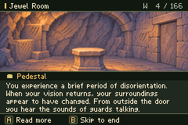
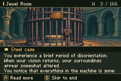
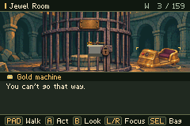

# Zork III re-audit

Re-audited November 17, 2026 against the bundled **Zork III Release 25, serial 860811**. The main report records the route, branch, connected-scene, interface, drop, and persistence checks; the follow-up section below records subsequent code and artwork changes from the gap-closing pass.

## Result

| Area | Status | Evidence |
| --- | --- | --- |
| Story routes and outcomes | **Pass, sampled** | All 28 route and branch scripts completed without harness errors. Main mirror, alternate mirror, and potion/Guardians routes each reached the expected 7/7 potential. Wrong actions, refusals, timed outcomes, deaths/revival, and puzzle branches were exercised. The terminal control screen was not replayed in a fresh GBA build. |
| Connected scenery and state art | **Pass, sampled; ending issue** | No new mismatch was found in the reviewed lake/underwater/shores, aqueduct/high arch/slide/damp passage, beam/button rooms, mirror halls/mechanism, Vista destinations, museum entrances, or prison/parapet sets. The red beam stays low in both connected rooms. The eight-state face now reads as a numbered stone sundial; its pointer follows the selected mark. The Treasury now has distinct treasure, map, and desk scenery, but the story's Master/player transformation has no matching character or transition cue. |
| Character and item placement | **Issue** | The three Crown Jewels do not appear on their described pedestal inside the present/947 cage. In unfinished 776, the takeable ring also has no visible sprite on its intended pedestal. Their sprites exist, but the parented contents are not composed into these views. See the captures below. |
| Focus, menus, and UI access | **Pass, sampled; terminal native check unchecked** | Expanded sweep covered 64 room states, 193 focus targets, 354 bag entries, 4,496 argument pickers, 62,015 menu rows, and 5,424 matching scene crops. The 31 sampled focus-marker checks had no clipped markers. Guardian-group and robot-proxy “missing visual” entries are not real scene omissions: they are group/local proxies, and the 776 story says the guards are outside. Current source has a dedicated Restart/Restore/Quit screen; its latest ROM behavior still needs a native replay. |
| Drops and crowded rooms | **Pass, sampled** | 214 floor-item selections across 48 crowded states produced zero absent or clipped selection markers. Five accepted museum floor drops remained after leaving/returning and after Restore; the separate lantern drop/return/Restore/Continue check also passed. The Royal Puzzle book remains visible in its floor-item strip below the map and above story text. |
| Save, Restore, Continue | **Issue** | Lantern, pushed time machine, hidden/recovered ring, secret door, bronze door, and ordinary floor items kept their logical state through the sampled transitions and saves. In the Royal Puzzle, walls restore logically, but Restore and launcher Continue clear the diagram and show “Press B to survey the puzzle.” Rebuilding it with Look/B advances one story turn. |
| Catalog coverage | **Route evidence classified for all 13 former gaps; 5 new stable routes** | Real routes capture Technology Museum 5, Museum Entrance 173, Royal Puzzle Entrance 84, Side Rooms 130/188, Narrow Rooms 119/221, and newly traced Narrow Rooms 51/58/161/178 plus Drafty Room 228. The remaining eight IDs have recorded transient, fatal, or trap outcomes; 20/138 and 48/151 still have no safe stable gameplay route in the paths traced. |

### Jewel Room captures

These are 240 × 160 production-renderer captures. The descriptions identify the jewels and their pedestal; no jewel sprites are visible in the corresponding scenes.

## Follow-up list

1. **Render the Crown Jewels on their story-owned support.** Compose the ring, jewelled knife, and sceptre on the cage pedestal in the present and 947 views; at 776, show the takeable ring and any other jewels the current story state places there. Make take/drop remove or relocate each sprite correctly, preserve the cage bars and pedestal perspective, and confirm focus markers remain usable at native resolution.
2. **Illustrate the final transformation.** Add a clear Master/player cue during the Treasury narration, then confirm the final scene uses the dedicated Restart/Restore/Quit controls in a fresh GBA build.
3. **Keep the Royal Puzzle diagram through Restore and Continue.** Rebuild the display from restored logical walls without issuing a story command or changing move count/random state. Check selection and the floor-item strip immediately after each recovery path.
4. **Find safe routes for the remaining trapped or implied destinations.** Rooms 20/138 are only declared as exits from timed room 57; rooms 48/151 are behind the Guardian-side mirror position where the traced exit is closed or lethal. Their forced catalog previews remain diagnostic. Route scripts and outcomes are recorded in [route coverage](zork-iii-route-coverage.md).

## Follow-up implementation status

Updated November 17, 2026:

- The renderer now composes the story-owned ring, jewelled knife, and sceptre on the existing pedestal in the 948, 947, and 776 Jewel Room views. It checks each jewel's current parent, restores the foreground cage bars over the 948/947 props, and draws focus corners above the bars.
- The successful Treasury ending now shows two identical Dungeon Masters on the page describing the transformation, then one Master beside a mist cue after the counterpart disappears. The shared Restart / Restore / Quit screen remains available after the last story page.
- The saved Royal Puzzle grid is serialized with the chapter snapshot and restored with it. Scope refresh keeps that grid when Restore or Continue loads a snapshot; ordinary travel still invalidates the room-local display. The re-audit's host shim explicitly cleared the grid on Restore, so its `valid=0` result does not describe this production path. A fresh renderer/native replay is still needed to confirm the displayed result.
- Real in-story route captures now cover the 947 museum path: from the Technology Museum checkpoint, exit the gold machine, open the wooden door, go south to Museum Entrance 173, south to Royal Puzzle Entrance 84, then west to Side Room 130. From alternate entrance 143, west reaches the matching Side Room 188. Room 54's southwest/southeast routes reach Narrow Rooms 119/221.
- Added a dedicated Side Room background and a west opening in the Royal Puzzle Entrance artwork. The connected views now share the warm limestone and continuous floor.
- Added a matched Ladder Top/Bottom pair and a mine Dead End scene. The actual room-15 east action narrates Ladder Bottom 57 and immediately returns to Scenic Vista 124; the catalog links from 57 to 20 and 138 do not establish stable screens.
- Reworked the Narrow Room set from the story text: the opposite wall is plain rock, the unmentioned floor compass is gone, the mirror faces the described east/west wall, and the two statue descriptions have distinct near-reflection and distant-pair artwork. Focus anchors for visible mirror, panel, and statue targets were checked in the diagnostic renderer.
- Fixed the catalog-preview harness to issue `look` before it captures. Its earlier room-48 image paired Narrow Room art with leftover Dead End text and coal from the previous diagnostic room; that was a capture-order error, not a player route. New catalog previews show each room's own title and description.
- The previous 13-entry route gap is now dispositioned with repeatable traces: Narrow Rooms 51/58/161/178 and Drafty Room 228 are stable; 57 and 70 are timed transitions; 210 and 225 are fatal/death narration; and 20/138 plus 48/151 have no safe stable route in the traced paths. The exact route files, logs, captures, and saved Drafty Room checkpoint are under `build/zork-iii-audit/` and summarized in [route coverage](zork-iii-route-coverage.md).

No full GBA ROM build or mGBA replay was performed for this implementation update. The host renderer was rebuilt and used for the new route and diagnostic captures.

## Verification and limits

- `make test` passes: all three stories, dictionary decoding, object menus, puzzle maps, route history, and save recovery.
- The audit harness was rebuilt from the current C renderer and packed artwork. Fresh captures and logs are in [`build/zork-iii-audit`](qa/mgba-room-gallery/route-data/zork-iii-audit/); key records are [`probe-expanded.log`](qa/mgba-room-gallery/route-data/zork-iii-audit/probe-expanded.log), [`connected-visual-refresh.log`](qa/mgba-room-gallery/route-data/zork-iii-audit/connected-visual-refresh.log), [`drop-stress.log`](qa/mgba-room-gallery/route-data/zork-iii-audit/drop-stress.log), [`persistence.log`](qa/mgba-room-gallery/route-data/zork-iii-audit/persistence.log), and [`optional-eras.log`](qa/mgba-room-gallery/route-data/zork-iii-audit/optional-eras.log).
- The full-GBA toolchain is unavailable here (`arm-none-eabi-gcc` is not installed), so this pass does not claim a freshly built ROM or a new mGBA replay. The screenshots use the production C room renderer at native screen size.
- The existing [per-screen capture matrix](zork-iii-audit-screens.csv) provides the captured-state inventory and unchecked-room list; its issue labels are from the initial audit, so use this report for current dispositions. The [connected-scene comparison](zork-iii-consistency-pass.md) and [shared screen checklist](qa-screen-checklist.md) provide supporting evidence and acceptance rules. The earlier [initial Zork III audit](zork-iii-audit.md) is retained as historical context; its completed findings are superseded by the connected-scene work and this re-audit.
- [Route coverage and reproducible checkpoints](zork-iii-route-coverage.md) distinguish real in-story captures from forced catalog diagnostics and list the remaining route-state gaps. The [paired mine artwork notes](assets/zork-iii-mine-art.md) and [mirror room mapping](assets/zork-iii-mirror-art.md) record the shared-feature continuity rules.
